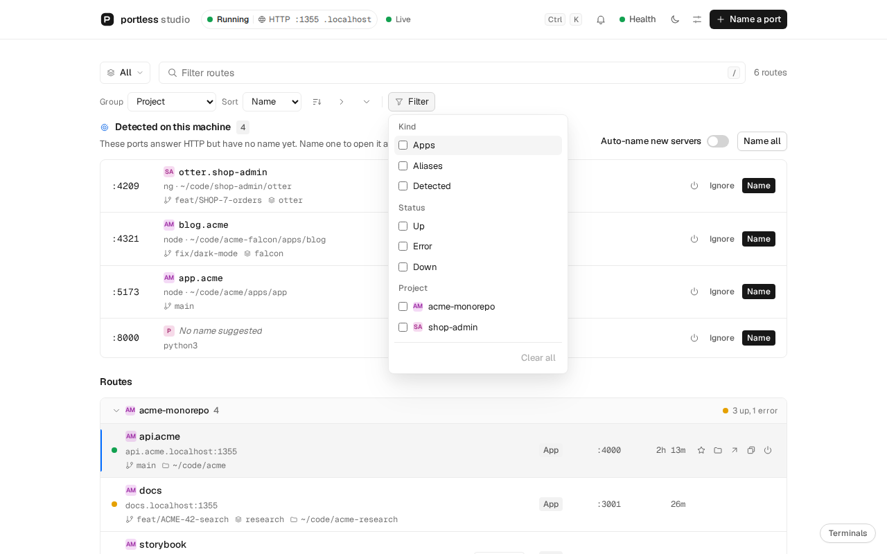
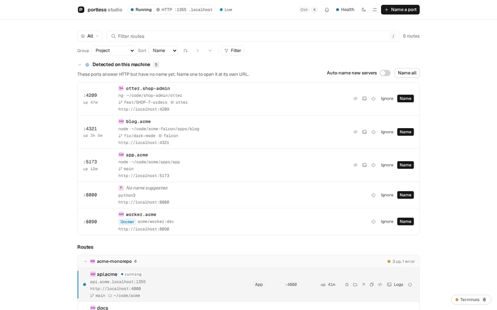

# portless studio

[](https://www.npmjs.com/package/portless-studio)
[](https://github.com/keven-bardales/portless-studio/actions/workflows/ci.yml)

A local web dashboard for [portless](https://github.com/vercel-labs/portless): see every dev server
on your machine, give each one a name like `web.myapp.localhost`, and open it from one page.

<picture>
  <source media="(prefers-color-scheme: dark)" srcset="docs/images/dashboard-dark.png">
  
</picture>

portless replaces port numbers with names: `portless api pnpm dev` serves your app at
`http://api.localhost:1355` instead of `http://localhost:3000`. It has no interface of its own, so
with ten dev servers across several projects you have to remember which names exist and which
ports have none. Studio shows both, live, and names a port in one click.



The screenshots use the built-in sample data (`?demo`), not a real machine.

## Install

Requires Node 22 or later.

To try it, run it straight from npm:

```bash
npx portless-studio init
```

For everyday use, and always for "start at login", install it globally:

```bash
npm i -g portless-studio
portless-studio init
```

The login service starts Studio from the files npm installed. Run through `npx`, those files sit in
npm's cache, which npm can clear at any time, and then Studio stops starting at login.

To update, install the latest version and restart Studio:

```bash
npm i -g portless-studio@latest
```

To remove it, undo the setup first, then remove the package:

```bash
portless-studio uninstall
npm rm -g portless-studio
```

## Quick start

`init` asks a few questions and leaves everything working:

- Checks that portless is installed and offers to install it with `npm install -g portless`.
- Asks for the basic settings (auto mode, start at login, port, open the browser) and saves them.
- Finds the dev servers already running, suggests a name for each and names them in portless.
- Starts the portless proxy on port 1355 over HTTP, which needs no password, certificate or extra
  tool on macOS, Windows or Linux, and can set Studio to start when you log in.

`init --yes` accepts every default without asking. After that, `portless-studio` starts
Studio at `http://127.0.0.1:4949`, registers it in portless as `studio` and opens your browser.
Your apps open at names like `http://web.myapp.localhost:1355`: Chrome, Edge and Firefox send
every `*.localhost` name to your own machine, with no hosts file and no DNS setup.

To try the page without portless, start Studio and open `http://127.0.0.1:4949/?demo` for sample
data, or `?demo&noportless` to walk through the install flow with a fake install.

## What it does

- **Live list** of portless routes: name, URL, port, app or alias, uptime and any Tailscale, ngrok
  or Cloudflare tunnel. It updates as soon as a route appears or goes away.
- **Detected ports:** listening ports that answer HTTP but have no name yet, with the process, the
  project folder and a suggested name. Name one, name them all, or ignore one.
- **Docker containers:** ports a running container publishes show under Detected too, with a
  Docker badge and the image. A Docker Compose container is named after its service and project
  (`api.acme`), any other after the container. Stop runs `docker stop` after a confirmation. This
  needs the `docker` command and a running Docker (Engine, Desktop, OrbStack or Colima); without
  them Studio shows only ordinary processes.
- **Auto mode** (off by default): every new dev server gets its suggested name by itself, once
  it has shown up unnamed in two scans in a row, so a server started with `portless <name>` keeps
  the name portless gives it. Names auto mode gave are removed 10 minutes after their port closes.
- **Name a port** that portless did not start, such as a database in Docker (`db` gives
  `db.localhost`). Rename or remove those names later.
- **Where each server runs:** every row shows the git branch, the linked worktree and the project
  folder. A route whose server is down keeps the last place it ran.
- **Views:** group by project, worktree, kind or status, or into your own groups; sort, and
  filter by kind, status or project from the Filter button; save the combination as a named view
  and pick the one that opens by default.
- **Terminals:** run a command per project inside Studio and watch its output in a panel. You, the
  CLI and your AI agents drive the same terminals. See [docs/terminals.md](docs/terminals.md).
- **Agents:** an MCP server lets Claude Code, Cursor and other agents list, name and stop dev
  servers and run commands in Studio terminals. See [docs/mcp.md](docs/mcp.md).
- **Open with:** right-click a row to open its folder in an editor found on your machine (VS Code,
  Cursor, Zed, WebStorm, IntelliJ IDEA, Sublime Text), reveal it in the file manager or copy its
  path. Add your own apps in Settings.
- **Health:** each route's dot says whether its port answers. The Health panel and
  `portless-studio doctor` find a proxy left running as root, two proxies at once, an untrusted
  certificate or a taken port, and give the fix.
- **Proxy and Studio control:** start, stop or restart the portless proxy, and stop or restart
  Studio, from the page.
- **Stop a dev server** from its row, after a confirmation. Only your own processes on a port
  Studio shows.
- **Project icons:** the favicon the server serves, else one in the project folder, else the
  project's initials. Set an emoji or an image per project in Settings.
- **Notifications** in the page when a server is detected or named, and optionally from the
  operating system.
- **Install portless** from the page when the `portless` command is missing.
- **Keyboard first:** every action has a key, `?` lists them and `Ctrl+K` (`Cmd+K`) runs any of
  them by name.

## How naming works

A suggested name says what the work is, then the app, then the repository. The package
`@acme/web` in the `acme-monorepo` folder on the branch `feat/ED-1234-add-x` gets
`ed-1234.web.acme`, so two worktrees of one repository get different names. That is the order
portless uses for worktrees, `<branch>.<name>.localhost`.

Change it with `nameTemplate`, for example `{ticket}.{repo}` or `{package}-{port}`.
[docs/naming.md](docs/naming.md) lists every token and how empty or repeated parts are dropped.

Anything that names a route through the portless CLI also shows up in Studio:

```bash
portless web.myapp pnpm dev       # a dev server, at web.myapp.localhost
portless alias db.myapp 5432      # a port something else opened, at db.myapp.localhost
```

## Agents and MCP

`portless-studio mcp` is an [MCP](https://modelcontextprotocol.io) server on stdio. It talks to the
Studio already running, so whatever an agent changes shows up in the page at once. For Claude Code:

```bash
claude mcp add --scope user portless-studio -- npx -y portless-studio mcp
```

[docs/mcp.md](docs/mcp.md) has the setup for Cursor and other clients, the list of tools, and
instructions to paste into your agent so it names dev servers after the ticket or pull request.
`portless-studio list --json` and `doctor --json` give the same data to scripts.

## Terminals

```bash
portless-studio run -- pnpm dev
```

`run` starts the command in a Studio terminal in the current folder, prints its output here,
names the first port it opens and stops it on Ctrl+C. The terminal stays visible in the page.
[docs/terminals.md](docs/terminals.md) covers the panel, the CLI and the security rules.

## Platforms

Studio runs on Linux, macOS and Windows with Node 22 or later and installs nothing beyond portless. Each
feature uses tools the system already has (`/proc` on Linux, `lsof` on macOS, `netstat` and
PowerShell on Windows). [docs/platforms.md](docs/platforms.md) says what each system uses and what
does not work the same everywhere.

## Commands

| Command | What it does |
| --- | --- |
| `portless-studio` | Starts Studio with the settings from the config file. |
| `portless-studio init [--yes]` | The setup above. Safe to run again. |
| `portless-studio uninstall [--yes]` | Undoes the setup: removes the login service, the names auto mode gave and the `studio` name, and stops the proxy if Studio started it. Names you or an agent gave stay. Asks before deleting the settings folder. |
| `portless-studio service install` | Starts Studio when you log in: a systemd user unit on Linux, a LaunchAgent on macOS, a script in the Startup folder on Windows. |
| `portless-studio service uninstall` | Undoes `service install`. |
| `portless-studio service status` | Says whether the login service is installed and running. |
| `portless-studio config [--edit] [--json]` | Prints the config file path and contents, or opens it in `$EDITOR`. |
| `portless-studio doctor [--json]` | Checks portless, the proxy, the certificate, Studio's port and the login service, and prints the fix for each problem. Exits with 1 when something fails. |
| `portless-studio list [--json]` | Lists named routes and ports without a name. |
| `portless-studio mcp` | Runs the MCP server on stdio for AI agents. |
| `portless-studio run [--name <name>] [--cwd <dir>] -- <command...>` | Runs a command in a Studio terminal and names the port it opens. |
| `portless-studio open [target]` | Brings Studio to the front showing a route, project, terminal id or `port:<n>`. |

| Flag | Effect |
| --- | --- |
| `--port <n>` | Port for the dashboard on 127.0.0.1. Default: `port` in the config, 4949. `0` picks a free one. |
| `--no-open` | Do not open the browser. |
| `--no-register` | Do not register the `studio` name in portless. |
| `-y`, `--yes` | With `init` and `uninstall`: accept every default. |
| `-h`, `--help` | Show the help. |
| `-v`, `--version` | Show the version. |

| Environment variable | What it does |
| --- | --- |
| `PORTLESS_STUDIO_CONFIG` | Path of the config file. |
| `PORTLESS_STATE_DIR` | portless state folder. Default `~/.portless`. |
| `PORTLESS_BIN` | portless binary used to create and remove names. Default `portless`. |
| `PORTLESS_STUDIO_URL` | Studio that `mcp`, `list`, `run` and `open` talk to. Default `http://127.0.0.1:<port>`. |
| `PORTLESS_STUDIO_NO_UPDATE_CHECK` | `1` turns the daily update check off, whatever the config says. |
| `EDITOR` | Editor that `config --edit` opens. |

## Config file

Settings live in one JSON file: `~/.config/portless-studio/config.json` on Linux and macOS (or
under `$XDG_CONFIG_HOME`), `%APPDATA%\portless-studio\config.json` on Windows. `portless-studio
config` prints the path. Edit it by hand or from the Settings panel; a running Studio picks up the
changes without a restart. Missing fields take their default.

| Field | Default | What it does |
| --- | --- | --- |
| `port` | `4949` | Port Studio listens on, on 127.0.0.1. |
| `autoName` | `false` | Gives every new dev server a portless name automatically. |
| `autoRemoveAfterMinutes` | `10` | Minutes a name auto mode gave survives after its port closes. `0` keeps them. |
| `openBrowser` | `true` | Opens the browser when Studio starts. |
| `registerStudioAlias` | `true` | Registers Studio itself in portless as `studio`. |
| `startProxy` | `true` | Starts the portless proxy when Studio starts and it is not running. |
| `proxyPort` | `1355` | Port of that proxy. 1355 needs no administrator rights; 80 removes the port from URLs when the system lets you listen there (see the FAQ). |
| `proxyHttps` | `false` | Serves the names over HTTPS. See the FAQ. |
| `scanIntervalMs` | `3000` | How often Studio looks for new listening ports, in milliseconds (at least 1000). |
| `ignoredPorts` | `[]` | Ports never shown as detected and never named automatically. |
| `ignoredProcesses` | editors, chat apps, browsers | Process names whose ports are never shown. |
| `views` | one view, `All`, grouped by project | Saved views: grouping, sort, filters and custom groups. |
| `defaultViewId` | `"all"` | The view the page opens with. |
| `favorites` | `[]` | Routes pinned above every group, by name or as `"port:3000"`. |
| `desktopNotifications` | `false` | Notifies from an open Studio tab while it is in the background. |
| `systemNotifications` | `false` | Asks the operating system to notify when no Studio tab is open. |
| `nameTemplate` | `"{work}.{package}.{repo}"` | How suggested names are built. See [docs/naming.md](docs/naming.md). |
| `projectIcons` | `{}` | Icon per project: an emoji, an http(s) image URL or a `data:image` URL. |
| `checkForUpdates` | `true` | Once a day, asks npm whether a newer portless-studio exists. See "Update notice" below. |

The `--port`, `--no-open` and `--no-register` flags win over the file for one run. Apps you add to
the Open with menu live in `open-with.json` next to the config file.

### Update notice

Once a day Studio asks the npm registry for the latest version of portless-studio. When a newer
one exists, it prints one line on start and shows a banner in the page with the command to update;
dismissing the banner hides it until the next version. The request is a plain
`GET https://registry.npmjs.org/portless-studio/latest`: Studio sends nothing about your machine,
your projects or your routes. It gives up after 3 seconds and stays quiet when you are offline,
and it keeps the time of the last check in `update-check.json` next to the config file. It never
runs when the `CI` variable is set. Turn it off with `checkForUpdates: false`, the Settings
switch, or `PORTLESS_STUDIO_NO_UPDATE_CHECK=1`.

## Keyboard shortcuts

| Keys | Action |
| --- | --- |
| `j` / `↓`, `k` / `↑` | Next and previous row |
| `Home`, `End` | First and last row |
| `/` | Search routes |
| `Enter` or `o` | Open the selected route |
| `c` | Copy its URL |
| `r` | Rename an alias |
| `Delete` or `Backspace` | Remove an alias |
| `f` | Pin or unpin as favorite |
| `.` or `Shift+F10` | Open with, copy path and more |
| `t` | Open a terminal in its folder |
| `n` | Name a port |
| `v` / `Shift+V` | Next view / open the view menu |
| `Shift+F` | Open the filters |
| `[`, `]` | Collapse or expand all groups |
| `Ctrl+K` / `Cmd+K` | Command menu |
| `,` | Settings |
| `?` | All keyboard shortcuts |
| `Esc` | Close a dialog or cancel |

## Security

Studio is a local tool and only listens on `127.0.0.1`. It rejects requests whose `Host` or
`Origin` is not local, so other websites open in your browser cannot read your routes or call the
API. Every change (naming, removing, installing portless, controlling the proxy or Studio, stopping
a dev server, running terminals) also needs a token that changes on every run. The page reads it from
Studio, and browsers only let pages served by Studio itself read it. The portless install always runs the same fixed command.
A dev server can be stopped only when it belongs to your user and listens on a port Studio shows,
and Studio never runs a command that needs sudo. See [SECURITY.md](SECURITY.md) to report a
problem.

## FAQ

**Safari does not open `*.localhost` names.** Safari does not always send `.localhost` names to
your machine. Open Studio at `http://127.0.0.1:4949` and each app at `http://127.0.0.1:<its port>`,
or use Chrome, Edge or Firefox.

**Why does the URL have `:1355`?** Port 1355 needs no administrator rights on any system, so
Studio starts the proxy there by default and names open as `http://web.myapp.localhost:1355`.
Browsers treat plain HTTP on a `.localhost` name as a secure context, so most apps work as they
would on HTTPS. To drop the port, the proxy has to listen on port 80. The "Shorter URLs" check in
the Health panel and `portless-studio doctor` tests, without sudo, whether you may listen on port
80 and whether it is free:

- **Windows** usually allows it, and macOS often does; Studio tests instead of assuming. When the
  test passes, the Use port 80 button sets `proxyPort` to `80` and restarts the proxy, and names
  open as `http://web.myapp.localhost`.
- **Linux** lets only root listen below port 1024. Run
  `sudo sysctl -w net.ipv4.ip_unprivileged_port_start=80` once; it lets every user on the machine
  listen on port 80 and up, until the next restart. To keep it after a restart, also run
  `echo 'net.ipv4.ip_unprivileged_port_start=80' | sudo tee /etc/sysctl.d/99-portless-studio.conf`.
  Then run the checks again and choose Use port 80. Studio never runs sudo itself.

**How do I get HTTPS?** Set `proxyHttps` to `true` and trust the portless certificate:
`portless-studio doctor` prints the exact command for your system, and the Health panel shows it
too. HTTPS without a port number needs `proxyPort` `443`, which on Linux needs sudo once to start
the proxy.

**Does it work on Windows?** Yes, with Node 22 or later and PowerShell 5 (included in Windows 10 and 11).
Ports come from `netstat`, process details from PowerShell, and start at login uses a hidden
script in the Startup folder. Windows has no service manager Studio can ask, so the page can stop
Studio but not restart it, and the doctor only sees the proxy portless records.
[docs/platforms.md](docs/platforms.md) lists every difference.

**How does it relate to portless?** Studio is an independent project, not part of portless and not
made by its authors. It reads the state portless keeps in `~/.portless` and names routes through
the `portless` command, so anything you or an agent do with portless shows up in Studio, and
Studio never changes how portless works.

**How do I remove it?** Run `portless-studio uninstall` (or `npx portless-studio uninstall` if you
never installed it globally). It removes the login service, the names auto mode gave and the
`studio` name, stops the proxy if Studio started it, and asks before deleting the settings folder.
Then remove the package with `npm rm -g portless-studio`. portless itself stays installed; remove it with
`npm uninstall -g portless`.

## Development

```bash
git clone https://github.com/keven-bardales/portless-studio
cd portless-studio
pnpm install
pnpm dev          # API on :4949 and the web app with hot reload on :5173
pnpm test         # unit and component tests
pnpm typecheck
pnpm check        # lint and format check
pnpm build        # builds dist/, then `pnpm start` runs it
pnpm smoke        # starts the built CLI on a free port and checks the API answers
```

The code is split so the web app can talk to another backend later: see
[docs/architecture.md](docs/architecture.md). Conventions are in
[docs/conventions.md](docs/conventions.md), and [CONTRIBUTING.md](CONTRIBUTING.md) covers pull
requests.

## License

MIT, see [LICENSE](LICENSE).
